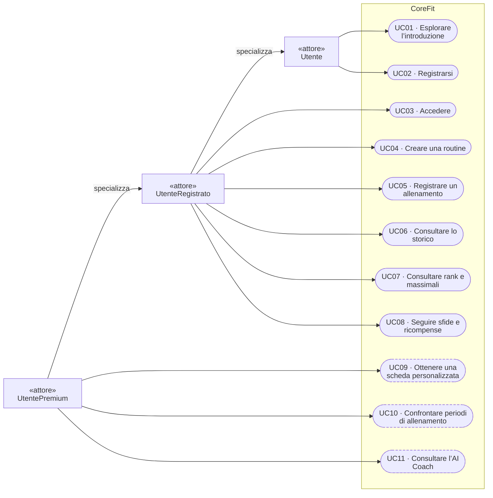

# CoreFit — Diario di allenamento con XP e rank

## Breve descrizione

CoreFit è un’app pensata per chi si allena con lo smartphone a portata di mano. Permette di preparare una routine, segnare le serie svolte e vedere sia i risultati fisici, come un nuovo record nello squat, sia i traguardi di costanza, come una sfida settimanale completata. [Apri il prototipo](https://corefit-mobile-preview.jauntynova15.chatgpt.site)

## Descrizione completa

Prima della seduta l’utente sceglie una routine pronta o ne crea una propria. Durante l’allenamento può correggere il peso, aggiornare le ripetizioni e spuntare le serie completate. Può anche interrompere la seduta e riprenderla. Al salvataggio, la sessione compare nello storico e il giorno si illumina nel calendario mensile.

Una serie di squat da **60 kg per 5 ripetizioni** produce risultati con significati diversi. Nello storico restano i dati effettivi della serie. Nella pagina Rank quella serie corrisponde a un massimale **stimato di 70 kg**. Nella dashboard la seduta contribuisce agli XP e, se è il primo allenamento della giornata, al conteggio dei giorni attivi. Chi svolge due sedute nello stesso giorno le ritrova entrambe nello storico e vede un solo quadrato acceso nel calendario.

**Stato del progetto.** Il prototipo web usa HTML, CSS e JavaScript. Routine, bozze, sessioni e stato di accesso sono salvati nel browser del dispositivo. L’accesso con username o email funziona con un account locale di prova. L’autenticazione online con Google e Apple, la sincronizzazione tra dispositivi e le funzioni Premium rientrano negli sviluppi previsti. [Codice del prototipo](prototype/)

## Target

| A chi si rivolge | Bisogno durante l’allenamento | Risposta di CoreFit |
| --- | --- | --- |
| Chi comincia ad allenarsi in palestra o a corpo libero | Sapere quale esercizio viene dopo e quali serie ha già svolto | Routine pronte e serie da spuntare |
| Chi si allena con regolarità | Ritrovare il carico dell’ultima seduta e leggere i progressi per esercizio | Storico delle serie, record e massimali stimati |
| Chi fatica a mantenere la costanza | Riconoscere i progressi anche quando i carichi restano stabili | Calendario, giorni consecutivi di allenamento (*streak*), XP e sfide |

## Competitor

- **Hevy** combina diario, routine e grafici con una componente sociale. Gli utenti possono seguire altri atleti e salvare le loro routine. [Sito ufficiale di Hevy](https://www.hevyapp.com/)
- **Strong** è un diario per l’allenamento con i pesi. Permette di pianificare le sedute e, con Strong PRO, seguire le serie migliori e il massimale per esercizio. [Sito ufficiale di Strong](https://www.strong.app/)

### Analisi SWOT di Hevy

| Fattore | Analisi dal punto di vista di Hevy |
| --- | --- |
| **S · Punto di forza interno** | Un utente può vedere la routine di un compagno, salvarla e usarla nella propria seduta. La condivisione si collega direttamente al diario. [Funzioni di Hevy](https://www.hevyapp.com/) |
| **W · Punto di debolezza interno** | Il piano gratuito consente di creare fino a quattro routine. Un atleta che alterna cinque schede incontra già questo limite. [Confronto ufficiale tra Free e Pro](https://help.hevyapp.com/hc/en-us/articles/35119778922263-Hevy-Pro-Subscription-How-to-get-Pro-and-What-Does-It-Include) |
| **O · Opportunità esterna** | Palestre e gruppi sportivi che condividono schede tra iscritti sono un possibile canale di adozione. Una routine condivisa può far conoscere l’app a tutto il gruppo. |
| **T · Minaccia esterna** | Strong copre lo stesso bisogno di annotare serie e seguire i progressi. Chi cerca soprattutto un diario individuale ha quindi un’alternativa diretta. [Strong](https://www.strong.app/) |

Per CoreFit la scelta progettuale è rendere visibile il **progresso personale**. Ogni esercizio ha un proprio rank e contribuisce allo stesso modo al rank generale, anche quando il numero di serie svolte è diverso.

## Attori e funzionalità

Il modello comprende **tre ruoli**. La stessa persona può utilizzare CoreFit in ruoli diversi.

| Attore | Compito e relazione con gli altri ruoli |
| --- | --- |
| Utente | Ruolo di base. Può esplorare l’introduzione e registrarsi se deve ancora creare l’account. |
| UtenteRegistrato | Specializza Utente. Ha un account e, dopo l’accesso, può preparare routine, registrare sedute e consultare i propri progressi. |
| UtentePremium | Specializza UtenteRegistrato. Nel prodotto previsto eredita le funzioni del diario e accede a schede personalizzate, analisi avanzate e AI Coach. |

### Criterio e valore attribuito

Per stimare la **complessità funzionale** usiamo i pesi degli *Use Case Points*. Tutti e tre gli attori interagiscono tramite un’interfaccia grafica, quindi ciascun ruolo è di tipo **complesso** e ha peso **3**. Per i casi d’uso il criterio è il numero stimato di transazioni, cioè scambi significativi tra persona e sistema. Ripetere la stessa operazione su più serie conta una volta.

| Tipo di caso d’uso | Criterio | Valore attribuito |
| --- | --- | ---: |
| Semplice | Da 1 a 3 transazioni | 5 punti |
| Medio | Da 4 a 7 transazioni | 10 punti |
| Complesso | Da 8 transazioni in su | 15 punti |

La colonna **N. attori** conta i ruoli associati direttamente al caso d’uso. Per esempio, UC05 ha un’associazione diretta con UtenteRegistrato e anche UtentePremium può svolgerlo per ereditarietà. I punti della tabella servono a stimare il lavoro sul prodotto e sono distinti dagli XP guadagnati in allenamento.

| ID | Funzionalità | Chi la svolge | N. attori diretti | Transazioni stimate | Tipo e valore | Stato |
| --- | --- | --- | ---: | ---: | --- | --- |
| UC01 | Esplorare l’introduzione | Utente | 1 | 2 | Semplice · 5 | Disponibile nella demo |
| UC02 | Registrarsi | Utente | 1 | 2 | Semplice · 5 | Disponibile nella demo |
| UC03 | Accedere | UtenteRegistrato | 1 | 2 | Semplice · 5 | Disponibile nella demo |
| UC04 | Creare una routine | UtenteRegistrato | 1 | 4 | Medio · 10 | Disponibile nella demo |
| UC05 | Registrare un allenamento | UtenteRegistrato | 1 | 4 | Medio · 10 | Disponibile nella demo |
| UC06 | Consultare lo storico | UtenteRegistrato | 1 | 3 | Semplice · 5 | Disponibile nella demo |
| UC07 | Consultare rank e massimali | UtenteRegistrato | 1 | 2 | Semplice · 5 | Disponibile nella demo |
| UC08 | Seguire sfide e ricompense | UtenteRegistrato | 1 | 3 | Semplice · 5 | Disponibile nella demo |
| UC09 | Ottenere una scheda personalizzata | UtentePremium | 1 | 4 | Medio · 10 | Prevista, Premium |
| UC10 | Confrontare periodi di allenamento | UtentePremium | 1 | 3 | Semplice · 5 | Prevista, Premium |
| UC11 | Consultare l’AI Coach | UtentePremium | 1 | 3 | Semplice · 5 | Prevista, Premium |

**Esempio di stima.** In UC05 l’utente apre una routine, registra peso e ripetizioni, conferma le serie svolte e infine salva la seduta ricevendo il riepilogo. Questi quattro scambi assegnano al caso d’uso il peso 10.

## Diagramma dei casi d’uso

Il rettangolo delimita il sistema **CoreFit**. Gli attori sono all’esterno. Le frecce verso gli ovali indicano le associazioni dirette. Tra due attori, la freccia punta dal ruolo specializzato al ruolo generale. Il contorno tratteggiato identifica le funzioni Premium previste.



<details>
<summary>Sorgente LaTeX del diagramma per la presentazione</summary>

Per ottenere il diagramma in PDF, incolla il seguente documento in `main.tex` di un progetto vuoto e compila con pdfLaTeX. Nel disegno UML il triangolo vuoto indica la generalizzazione. [Apri Overleaf](https://www.overleaf.com/)

```latex
\documentclass[tikz,border=5mm]{standalone}
\usepackage[T1]{fontenc}
\usetikzlibrary{arrows.meta,shapes.geometric}

\begin{document}
\begin{tikzpicture}[
  font=\small, caso/.style={draw,ellipse,minimum height=7mm,minimum width=7.1cm},
  previsto/.style={dashed}, associazione/.style={-{Stealth[length=1.8mm]}},
  eredita/.style={-{Triangle[open,length=3mm]}}
]
  % L'attore ha tre punti di collegamento: alto, basso e mano destra.
  \newcommand{\attore}[3]{%
    \begin{scope}[shift={(0,#2)}]
      \draw (0,.34) circle (.13);
      \draw (0,.21)--(0,-.12) (-.25,.08)--(.25,.08)
            (0,-.12)--(-.2,-.42) (0,-.12)--(.2,-.42);
      \node[anchor=east] at (-.32,0) {#3};
      \coordinate (#1mano) at (.25,.08);
      \coordinate (#1alto) at (0,.5);
      \coordinate (#1basso) at (0,-.46);
    \end{scope}}
  \attore{U}{-.5}{Utente}
  \attore{R}{-4.5}{UtenteRegistrato}
  \attore{P}{-9}{UtentePremium}
  \draw[eredita] (Ralto)--(Ubasso);
  \draw[eredita] (Palto)--(Rbasso);

  \draw (2,1.25) rectangle (10.3,-10.6);
  \node[font=\bfseries] at (6.15,.85) {CoreFit};
  \newcommand{\caso}[4][]{\node[caso,#1] (#2) at (6.15,#3) {#2\enspace #4};}
  \caso{UC01}{0}{Esplorare l'introduzione}
  \caso{UC02}{-1}{Registrarsi}
  \caso{UC03}{-2}{Accedere}
  \caso{UC04}{-3}{Creare una routine}
  \caso{UC05}{-4}{Registrare un allenamento}
  \caso{UC06}{-5}{Consultare lo storico}
  \caso{UC07}{-6}{Consultare rank e massimali}
  \caso{UC08}{-7}{Seguire sfide e ricompense}
  \caso[previsto]{UC09}{-8}{Ottenere una scheda personalizzata}
  \caso[previsto]{UC10}{-9}{Confrontare periodi di allenamento}
  \caso[previsto]{UC11}{-10}{Consultare l'AI Coach}

  \foreach \uc in {UC01,UC02}{\draw[associazione] (Umano)--(\uc.west);}
  \foreach \uc in {UC03,UC04,UC05,UC06,UC07,UC08}{\draw[associazione] (Rmano)--(\uc.west);}
  \foreach \uc in {UC09,UC10,UC11}{\draw[associazione] (Pmano)--(\uc.west);}
\end{tikzpicture}
\end{document}
```

</details>

## User stories

Ogni riga corrisponde all’associazione con lo stesso ID nel diagramma. Le ultime tre storie descrivono l’esperienza Premium prevista.

| Caso | Come… | Voglio… | Per… |
| --- | --- | --- | --- |
| UC01 | Utente | esplorare le tre schermate introduttive | capire che cosa posso registrare prima di creare un account. |
| UC02 | Utente | registrarmi | scegliere uno username con cui ritrovare i miei allenamenti nello stesso browser. |
| UC03 | UtenteRegistrato | accedere al mio account | riprendere il mio diario usando username o email e password. |
| UC04 | UtenteRegistrato | creare una routine | ritrovare esercizi, serie e ripetizioni già impostati alla seduta successiva. |
| UC05 | UtenteRegistrato | registrare una seduta serie per serie | ricordare carichi e ripetizioni che ho completato, anche se ho modificato la routine durante la seduta. |
| UC06 | UtenteRegistrato | consultare lo storico mensile | vedere in quali giorni mi sono allenato e confrontare le serie di due sedute. |
| UC07 | UtenteRegistrato | consultare rank e massimali | capire come sono progredito nello squat e da quale serie deriva il mio massimale stimato. |
| UC08 | UtenteRegistrato | seguire sfide e ricompense | vedere quante serie mi mancano per completare la sfida settimanale. |
| UC09 | UtentePremium | ottenere una scheda su misura | distribuire gli esercizi nei giorni in cui posso allenarmi. |
| UC10 | UtentePremium | confrontare due periodi di allenamento | capire quali gruppi muscolari ho allenato di più rispetto al mese precedente. |
| UC11 | UtentePremium | fare una domanda all’AI Coach sulla mia scheda | capire perché la mia scheda propone un esercizio e quali alternative ho. |

## Modello Agile

Per organizzare il progetto proponiamo **sprint di due settimane**. Le user stories formano il *product backlog*. All’inizio di ogni sprint si scelgono le storie prioritarie e si concorda una prova di accettazione. Alla fine si mostra un percorso completo su telefono, si raccolgono i commenti degli utenti e in retrospettiva si decide cosa migliorare nello sprint successivo.

| Ordine di priorità | Obiettivo dello sprint | Esempio di criterio di accettazione |
| --- | --- | --- |
| 1 · Diario utilizzabile | Dall’introduzione al primo allenamento salvato (UC01–UC05) | Creo una routine, spunto una sola serie e salvo. Riaprendo il browser ritrovo la sessione con la sola serie completata. |
| 2 · Risultati leggibili | Storico, rank e massimali (UC06–UC07) | Due sedute nello stesso giorno accendono una sola casella. Una serie da 60 kg × 5 produce una stima di 70 kg. |
| 3 · Costanza | Sfide e ricompense (UC08) | Raggiungo le 12 serie settimanali e ricevo il bonus una volta sola, anche ricaricando la pagina. |
| 4 · Premium, in backlog | Validare per prima la scheda personalizzata (UC09), poi approfondire UC10 e UC11 | Per UC09, indicando tre giorni disponibili ricevo una scheda distribuita su quei tre giorni. |

Una storia è **completata** quando il percorso è utilizzabile da smartphone, il criterio di accettazione è stato verificato e la demo riflette il comportamento descritto. La tabella propone un piano di lavoro per il progetto scolastico.

## Come provare CoreFit

Dalla cartella principale del repository avvia il server locale con `python3 -m http.server 8000`. In PowerShell puoi usare `py -m http.server 8000` oppure `python -m http.server 8000`. Sul computer apri [il prototipo locale](http://localhost:8000/prototype/). Per provarlo dal telefono usa l’[anteprima online](https://corefit-mobile-preview.jauntynova15.chatgpt.site).

Per la dimostrazione usa un indirizzo e una password di prova. Il browser conserva un solo account locale e verifica la password con PBKDF2. La sessione resta attiva fino all’uscita esplicita. L’integrazione dei provider di accesso e il recupero password sono sviluppi futuri. [Codice dell’accesso](prototype/auth.js)

<details>
<summary>Regole di calcolo del prototipo</summary>

- **XP e livelli.** Ogni seduta salvata assegna 20 XP più 10 per serie completata, oltre agli eventuali bonus. Ogni 200 XP si sale di livello. Gli XP guadagnati restano acquisiti al rinnovo delle sfide. [Regole delle ricompense](prototype/gamification.js)
- **Rank.** Per ogni serie si assegnano `round(10 + min(ripetizioni, 30) + min(peso_kg, 300) / 10 + bonus_record)` punti. Il bonus è 15 per un nuovo record dell’esercizio, altrimenti 0. I nove rank sono WOOD, BRONZE, SILVER, GOLD, PLATINUM, DIAMOND, CHAMPION, TITAN e OLYMPIAN, ciascuno con divisioni III, II e I. La soglia della divisione di indice `n` è `80n + 12n²`, da 0 a 26. Il rank generale è la media arrotondata degli indici degli esercizi svolti. [Calcolo dei rank](prototype/ranks.js)
- **Massimale stimato (1RM).** Con una ripetizione si usa il peso registrato. Da 2 a 10 ripetizioni si applica la formula di Epley, `peso × (1 + ripetizioni / 30)`. Per ogni esercizio viene mostrata la stima più alta con la serie e la data di origine. Una serie a 0 kg o con più di 10 ripetizioni è esclusa dalla stima. [Calcolo del massimale](prototype/ranks.js)

</details>
